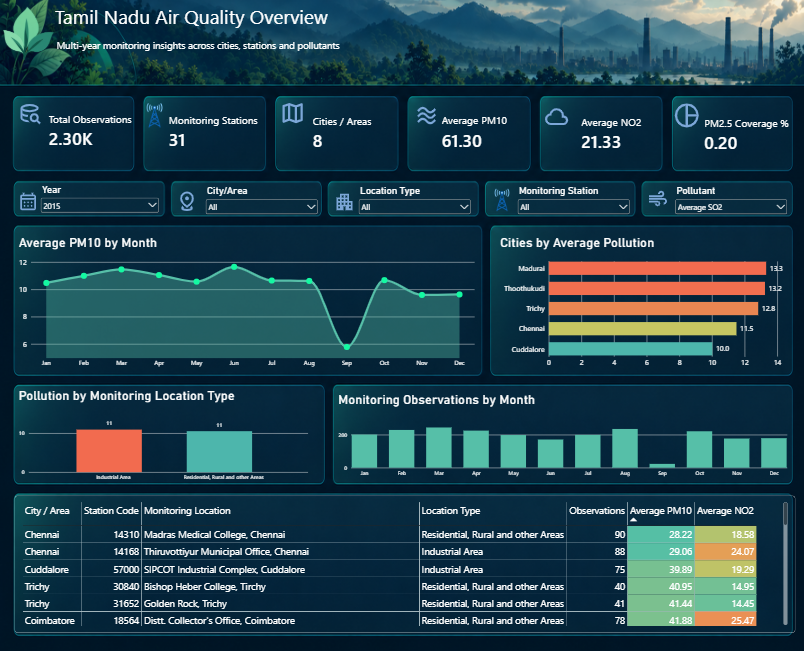
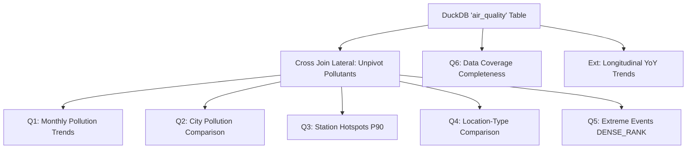

# Tamil Nadu Air Quality Analysis

An end-to-end data analytics and business intelligence project analyzing ambient air quality monitoring data across Tamil Nadu, India. The project transitions from raw government monitoring files through schema standardization, defensive data cleaning, and data quality validation into an analytical storage layer (Parquet and DuckDB), multi-dimensional SQL analysis, and an interactive Power BI executive dashboard.

---

## Dashboard Preview



*The single-page interactive Power BI dashboard enables environmental analysts and decision-makers to evaluate longitudinal pollution concentrations across Tamil Nadu. Users can filter by calendar year, city/area, monitoring location type, individual station, and target pollutant. The interface dynamically updates high-level KPIs, monthly concentration curves, city rankings with sample reliability safeguards, location-type comparisons, monitoring frequency distributions, and detailed station-level audit tables.*

---

## Table of Contents

- [1. Project Overview](#1-project-overview)
- [2. Business & Analytical Problem](#2-business--analytical-problem)
- [3. Key Analytical Questions](#3-key-analytical-questions)
- [4. Dataset Overview & Scope](#4-dataset-overview--scope)
- [5. Data Dictionary](#5-data-dictionary)
- [6. Data Quality & Defensive Cleaning](#6-data-quality--defensive-cleaning)
- [7. Important Data Provenance Note](#7-important-data-provenance-note)
- [8. Data Processing Pipeline](#8-data-processing-pipeline)
- [9. Technical Stack](#9-technical-stack)
- [10. Repository Structure](#10-repository-structure)
- [11. SQL Analysis](#11-sql-analysis)
  - [Question 1 — Monthly Pollution Patterns](#question-1--monthly-pollution-patterns)
  - [Question 2 — City-Level Pollution Comparison](#question-2--city-level-pollution-comparison)
  - [Question 3 — Monitoring Station Hotspots](#question-3--monitoring-station-hotspots)
  - [Question 4 — Location-Type Comparison](#question-4--location-type-comparison)
  - [Question 5 — Extreme Pollution Observations](#question-5--extreme-pollution-observations)
  - [Question 6 — Data Coverage & Monitoring Reliability](#question-6--data-coverage--monitoring-reliability)
  - [Analytical Extension — Year-over-Year Trends](#analytical-extension--year-over-year-trends)
- [12. Key Findings & Insights](#12-key-findings--insights)
- [13. Power BI Dashboard Architecture](#13-power-bi-dashboard-architecture)
- [14. Power BI Data Model & DAX](#14-power-bi-data-model--dax)
- [15. Dashboard Visual & UI Design](#15-dashboard-visual--ui-design)
- [16. Analytical Limitations & Caveats](#16-analytical-limitations--caveats)
- [17. Reproducibility & How to Run](#17-reproducibility--how-to-run)
- [18. Project Outputs & Deliverables](#18-project-outputs--deliverables)
- [19. Conclusion](#19-conclusion)
- [20. Future Extensions](#20-future-extensions)
- [21. Author & Contact](#21-author--contact)

---

## 1. Project Overview

This project delivers an end-to-end analytics workflow evaluating ambient air quality monitoring records across the state of Tamil Nadu, India. Ambient air quality monitoring is a foundational public health domain: regulatory authorities, urban planners, and environmental epidemiologists rely on continuous and manual monitoring stations to detect industrial pollution, evaluate vehicular emissions, and formulate emission control policies.

However, historical environmental datasets published by government agencies are frequently fragmented across multiple reporting years, feature evolving schemas and column naming conventions, and contain uneven observation frequencies. 

This project bridges the gap between raw data collection and actionable analytical intelligence by integrating four core disciplines:
1. **Data Engineering & Preparation:** Resilient ingestion, column alias resolution, schema canonicalization, and high-performance columnar storage.
2. **Defensive Data Quality Auditing:** Preservation of genuine missingness without silent data loss or arbitrary zero-imputation, validation of temporal bounds, and duplicate detection.
3. **In-Process SQL Analytics:** DuckDB analytical queries computing non-parametric distributions, percentile benchmarks ($P_{90}$), and sample-size-screened rankings.
4. **Power BI Business Intelligence:** Dimensional modeling, dynamic DAX parameter measures, screening floor indicators, and an executive dark-themed analytical dashboard.

The overarching objective is to convert raw, disparate monitoring logs into defensible, audit-ready analytical assets without distorting historical reality.

---

## 2. Business & Analytical Problem

In environmental monitoring analytics, naive analysis frequently leads to invalid conclusions. Real-world monitoring networks do not sample all locations continuously: stations go offline for maintenance, equipment is added over successive fiscal years, and non-continuous manual monitoring programmes typically operate on a non-daily schedule (such as 2 days per week, yielding approximately 104 possible sampling days per year).

When analysts calculate aggregate metrics without considering data quality and coverage, three critical errors emerge:
- **Zero-Imputation Bias:** Treating missing pollutant records as zero concentration artificially depresses calculated averages, understating public health hazards.
- **Sparse Sample Distortion:** Ranking a monitoring station or city with 8 valid observations against one with 104 valid observations misrepresents chronic baseline air quality.
- **Conflating Mass Concentration with Risk:** Comparing raw concentrations of different chemical species directly (such as comparing $25\,\mu\text{g/m}^3$ of $\text{SO}_2$ to $25\,\mu\text{g/m}^3$ of $\text{PM}_{10}$) ignores their differing molecular behaviors, toxicity profiles, and statutory standards.

### Core Investigation Scope
This project investigates:
- **Temporal Variability:** How observed concentrations of each monitored pollutant fluctuate across months and historical years.
- **Spatial Distribution:** How recorded concentrations differ across monitored cities and urban agglomerations in Tamil Nadu.
- **Zonal Disparities:** How pollution levels vary between designated Industrial Areas versus Residential, Rural, and Other Areas.
- **Network Coverage & Completeness:** How sampling frequency, active station counts, and pollutant missingness impact statistical reliability.
- **Localized Hotspots & Peak Episodes:** Which specific monitoring locations and dates exhibited peak observed concentrations, distinguishing baseline chronic exposure from acute pollution events.

Data quality validation is not merely a data-cleaning step in this context; it is a foundational analytical prerequisite for credible environmental reporting.

---

## 3. Key Questions

The analytical core of the project implements six primary SQL analysis queries (plus an overarching multi-year trend analysis) designed to answer specific business and regulatory questions:

| # | Question Title & Analytical Query | Business / Regulatory Purpose | Primary Output Artifact |
|---|---|---|---|
| **Q1** | **Monthly Pollution Patterns**<br>`monthly_pollution_trends` | Identifies seasonal pollution behavior per pollutant by month, isolating meteorological shifts from monitoring coverage changes. | [`outputs/monthly_pollution_trends.csv`](outputs/monthly_pollution_trends.csv) |
| **Q2** | **City-Level Pollution Comparison**<br>`city_pollution_comparison` | Ranks monitored cities by pollutant concentration while applying an analytical screening floor to prevent low-sample skew. | [`outputs/city_pollution_comparison.csv`](outputs/city_pollution_comparison.csv) |
| **Q3** | **Monitoring Station Hotspots**<br>`station_hotspots` | Pinpoints specific station locations recording elevated pollution, calculating 90th percentile ($P_{90}$) levels to capture persistent high-exposure zones. | [`outputs/station_hotspots.csv`](outputs/station_hotspots.csv) |
| **Q4** | **Location-Type Comparison**<br>`location_type_comparison` | Evaluates whether industrial zoning correlates with higher ambient pollution compared to residential and rural zones, calculating standard deviation and missingness. | [`outputs/location_type_comparison.csv`](outputs/location_type_comparison.csv) |
| **Q5** | **Extreme Pollution Observations**<br>`extreme_pollution_events` | Identifies the top 10 single-day peak concentration episodes per pollutant with exact station identifiers, locations, and dates. | [`outputs/extreme_pollution_events.csv`](outputs/extreme_pollution_events.csv) |
| **Q6** | **Data Coverage & Reliability**<br>`data_coverage` | Measures station longevity, total sampling days, and pollutant-specific completeness rates to verify which stations meet statistical reporting reliability. | [`outputs/data_coverage.csv`](outputs/data_coverage.csv) |
| **Ext**| **Year-over-Year Trends**<br>`yearly_pollution_trends` | Tracks multi-year state-level annual means and medians alongside active station and city counts, contextualizing network expansion. | [`outputs/yearly_pollution_trends.csv`](outputs/yearly_pollution_trends.csv) |

---

## 4. Dataset

### Data Source & Geographic Scope
The data originates from official ambient air quality monitoring published under the **National Air Quality Monitoring Programme (NAMP)** by the **Central Pollution Control Board (CPCB)** and the **Tamil Nadu Pollution Control Board (TNPCB)**.

- **Geographic Coverage:** State of Tamil Nadu, India.
- **Urban Areas Represented:** 8 major municipal/industrial areas:
  - Chennai
  - Coimbatore
  - Cuddalore
  - Madurai
  - Mettur
  - Salem
  - Thoothukudi (Tuticorin)
  - Trichy (Tiruchirappalli)
- **Monitoring Infrastructure:** 31 distinct monitoring stations operated primarily by the Tamil Nadu State Pollution Control Board and the National Environmental Engineering Research Institute (NEERI).
- **Temporal Horizon:** Multi-year records spanning calendar years **2011 through 2015** (sampling dates ranging from 2011-01-02 to 2015-12-31).
- **Total Multi-Year Volume:** **10,890 verified observations**.

### Yearly Breakdown of Monitored Data

| Monitoring Year | Source File | Records | Date Range | Active Cities | Active Stations |
|---|---|---:|---|---:|---:|
| **2011** | `air_quality_2011.csv` | 1,569 | 2011-01-02 to 2011-12-31 | 5 | 16 |
| **2012** | `air_quality_2012.csv` | 1,734 | 2012-01-02 to 2012-12-31 | 6 | 21 |
| **2013** | `air_quality_2013.csv` | 2,406 | 2013-01-02 to 2013-12-31 | 8 | 27 |
| **2014** | `air_quality_2014.csv` | 2,879 | 2014-01-02 to 2014-12-31 | 8 | 30 |
| **2015** | `air_quality_2015.csv` | 2,302 | 2015-01-02 to 2015-12-31 | 8 | 31 |
| **Total** | **Combined Pipeline** | **10,890** | **2011-01-02 to 2015-12-31** | **8** | **31** |

### Canonical Analytical Schema
The pipeline consolidates heterogeneous yearly headers into a strict 13-column canonical schema:

1. `data_year` *(INTEGER)*: Calendar year of monitoring.
2. `source_file` *(VARCHAR)*: Lineage pointer to the source CSV file.
3. `stn_code` *(VARCHAR)*: Regulatory alphanumeric identifier for the monitoring station.
4. `sampling_date` *(DATE)*: ISO-standardized sampling date (`YYYY-MM-DD`).
5. `state` *(VARCHAR)*: State jurisdiction (`Tamil Nadu`).
6. `city_town_village_area` *(VARCHAR)*: Monitored city or urban agglomeration.
7. `location_of_monitoring_station` *(VARCHAR)*: Human-readable site/building description where the monitoring sampler is mounted.
8. `agency` *(VARCHAR)*: Regulatory operating agency (e.g., TNPCB, NEERI).
9. `type_of_location` *(VARCHAR)*: Land-use classification (`Industrial Area` or `Residential, Rural and other Areas`).
10. `so2` *(DOUBLE)*: Ambient Sulphur Dioxide concentration ($\mu\text{g/m}^3$).
11. `no2` *(DOUBLE)*: Ambient Nitrogen Dioxide concentration ($\mu\text{g/m}^3$).
12. `rspm_pm10` *(DOUBLE)*: Respirable Suspended Particulate Matter ($\text{PM}_{10}$) concentration ($\mu\text{g/m}^3$).
13. `pm_2_5` *(DOUBLE)*: Fine Particulate Matter ($\text{PM}_{2.5}$) concentration ($\mu\text{g/m}^3$).

> [!IMPORTANT]
> **Station Identification Terminology:**
> In accordance with official CPCB monitoring metadata, there is **no separate "station name" column**. Monitoring entities are defined strictly by:
> - `stn_code`: The official numerical/alphanumeric station identifier (e.g., `237`, `766`, `38`).
> - `location_of_monitoring_station`: The specific physical mounting location description (e.g., `SIDCO Office, Coimbatore`, `Thiyagaraya Nagar, Chennai`).
> - `city_town_village_area`: The urban area in which the station resides (e.g., `Coimbatore`, `Chennai`).
> - `type_of_location`: The statutory land-use zoning category.

---

## 5. Data Dictionary

| Column Name | Data Type | Nullable | Description & Domain Meaning |
|---|---|:---:|---|
| `data_year` | Integer | No | The calendar year during which the ambient sample was taken (2011–2015). |
| `source_file` | Text | No | Original source CSV filename (e.g., `air_quality_2015.csv`) for data auditability and lineage tracking. |
| `stn_code` | Text | Yes | Official CPCB monitoring station identification code. Stored as text to prevent floating-point artifacts. |
| `sampling_date` | Date | No | Standardized date of sampling in `YYYY-MM-DD` ISO-8601 format. |
| `state` | Text | No | Geographic state name (`Tamil Nadu`). |
| `city_town_village_area` | Text | No | Monitored city, municipal corporation, or urban agglomeration. |
| `location_of_monitoring_station` | Text | Yes | Physical site description of the monitoring equipment installation. |
| `agency` | Text | Yes | Operating organization responsible for field sampling and laboratory analysis (TNPCB / NEERI). |
| `type_of_location` | Text | Yes | Categorical zoning: `Industrial Area` vs `Residential, Rural and other Areas`. |
| `so2` | Numeric (Float) | Yes | 24-hour average concentration of Sulphur Dioxide ($\text{SO}_2$) in microgram per cubic meter ($\mu\text{g/m}^3$). |
| `no2` | Numeric (Float) | Yes | 24-hour average concentration of Nitrogen Dioxide ($\text{NO}_2$) in microgram per cubic meter ($\mu\text{g/m}^3$). |
| `rspm_pm10` | Numeric (Float) | Yes | 24-hour average concentration of Respirable Suspended Particulate Matter ($\le 10\,\mu\text{m}$) in $\mu\text{g/m}^3$. |
| `pm_2_5` | Numeric (Float) | Yes | 24-hour average concentration of Fine Particulate Matter ($\le 2.5\,\mu\text{m}$) in $\mu\text{g/m}^3$. |

### Monitored Pollutant Overview

- **Sulphur Dioxide ($\text{SO}_2$):** A gaseous pollutant generated predominantly from the combustion of sulfur-containing fossil fuels (power stations, heavy manufacturing, refining).
- **Nitrogen Dioxide ($\text{NO}_2$):** A reactive gas emitted by internal combustion engines (vehicular exhaust) and high-temperature industrial combustion.
- **RSPM / $\text{PM}_{10}$:** Inhalable airborne particles with aerodynamic diameter $\le 10\,\mu\text{m}$, including windblown road dust, construction dust, and industrial particulate matter.
- **$\text{PM}_{2.5}$:** Fine inhalable particles with aerodynamic diameter $\le 2.5\,\mu\text{m}$ capable of penetrating deep into the pulmonary alveolar system; primarily derived from secondary combustion and vehicle exhaust.

> [!WARNING]
> **Raw Concentrations vs Air Quality Index (AQI):**
> All pollutant numeric values in this dataset represent **raw physical mass concentrations** measured in micrograms per cubic meter ($\mu\text{g/m}^3$). They are **not** dimensionless Air Quality Index (AQI) values. Calculating AQI requires applying multi-pollutant non-linear piecewise linear sub-index breakpoint equations specified by the CPCB. Raw concentrations of different pollutants must never be ranked or compared directly against one another.

---

## 6. Data Quality & Defensive Cleaning

Real-world environmental telemetry is prone to data entry irregularities, heterogeneous formatting, and intermittent sensor outages. This project enforces defensible data cleaning standards.

### 1. Missing Value Philosophy
- **Preservation of Genuine Missingness:** Missing pollutant measurements are strictly preserved as `NULL` / `NaN`.
- **Zero-Imputation Prohibition:** A missing sensor measurement indicates that a sample was not gathered, analyzed, or validated on that date. It does **not** indicate zero pollution. Replacing missing values with `0` would artificially drag down city and monthly averages, invalidating regulatory comparisons.
- **No Indiscriminate Row Deletion:** Records missing one pollutant (such as $\text{PM}_{2.5}$) still provide valid observations for $\text{SO}_2$, $\text{NO}_2$, and $\text{PM}_{10}$. Discarding entire rows due to single-column nulls would destroy valuable monitoring records.
- **No Arbitrary Imputation:** Values are never filled with forward-fill, backward-fill, or mean values, preserving the empirical integrity of the government records.
- **Treatment of Outliers:** Extreme observations (e.g., $\text{SO}_2 = 909\,\mu\text{g/m}^3$ or $\text{PM}_{10} = 776\,\mu\text{g/m}^3$) are not deleted; they are preserved as authentic acute episodes requiring analytical investigation.

### 2. Multi-Format Date Parsing & Validation
Historical CSV files utilized four distinct date string conventions: `DD-MM-YY` (e.g., `06-01-15`), `DD/MM/YYYY` (e.g., `06/01/2011`), `DD-MM-YYYY` (e.g., `15-08-2013`), and `YYYY-MM-DD`. The ingestion pipeline implements a deterministic multi-format parser:
- Zero records were dropped during date parsing.
- Zero invalid dates were produced across all 10,890 records.
- All sampling dates map verified calendar days between 2011-01-02 and 2015-12-31.

### 3. Duplicate & Anomaly Auditing
- **Exact Row Duplicates:** Deduplication audited all 10,890 rows. No exact duplicate rows were found in the consolidated analytical dataset.
- **Negative Concentration Checks:** Field samplers occasionally record negative numbers when calibration zero-drifts occur. The audit verified **zero negative values** across all four pollutants in the final dataset.

### 4. Pollutant Completeness & Missingness Summary

| Pollutant Parameter | Total Records | Valid Observations | Missing Count | Missingness Rate | Valid Measurement % |
|---|---:|---:|---:|---:|---:|
| **$\text{SO}_2$** | 10,890 | 10,776 | 114 | 1.05% | **98.95%** |
| **$\text{NO}_2$** | 10,890 | 10,780 | 110 | 1.01% | **98.99%** |
| **$\text{RSPM / PM}_{10}$** | 10,890 | 10,850 | 40 | 0.37% | **99.63%** |
| **$\text{PM}_{2.5}$** | 10,890 | 454 | 10,436 | 95.83% | **4.17%** |

### 5. Critical $\text{PM}_{2.5}$ Coverage Finding
A key finding of the data quality audit is the structural limitation of $\text{PM}_{2.5}$ records:
- Prior to 2014, routine $\text{PM}_{2.5}$ monitoring was not part of standard NAMP operations in Tamil Nadu; monitoring focused exclusively on $\text{SO}_2$, $\text{NO}_2$, and $\text{RSPM/PM}_{10}$.
- Across 2011, 2012, 2013, and 2014 raw datasets, $\text{PM}_{2.5}$ valid observation count is **0**.
- In the 2015 baseline dataset, $\text{PM}_{2.5}$ was introduced at a subset of stations, resulting in **454 valid observations** out of 2,302 records (**19.7% coverage / 80.28% missingness**).
- Consequently, any longitudinal multi-year trend for $\text{PM}_{2.5}$ reflects the progressive commissioning of monitoring hardware rather than an environmental trend.

---

## 7. Important Data Provenance Note

> [!CAUTION]
> **Data Provenance & Historical Authenticity Notice:**
> During an earlier exploratory iteration of this repository, synthetic multi-year files (2011–2014) were generated by replicating 2015 station coordinates and generating simulated Gaussian pollutant distributions. 
> 
> **Those synthetic files were superseded in commit `9f7ee6a`.** The repository now exclusively uses **authentic historical CPCB monitoring datasets** for 2011, 2012, 2013, 2014, and 2015. 
> 
> Any future researcher or analyst replicating this work must ensure that analytical queries run against the verified CPCB datasets (`data/raw/air_quality_2011.csv` through `air_quality_2015.csv`) and the consolidated Parquet database (`data/processed/tamil_nadu_air_quality.parquet`). Simulated or synthetic datasets must never be represented as empirical government observations.

---

## 8. Data Processing Pipeline

The project implements a modular, reproducible 11-stage data engineering and analytics pipeline:

```text
[1. Raw Ingestion]        Dynamic discovery of raw CSV files (resilient UTF-8 / latin-1 fallback)
        │
        ▼
[2. Data Profiling]       Initial header profiling, row counting, and format inspection
        │
        ▼
[3. Standardization]      Header alias mapping to 13-column canonical schema (alias dictionary)
        │
        ▼
[4. Cleaning Layer]       Text trimming, empty string normalization, multi-format date parsing
        │
        ▼
[5. Quality Validation]   Verification of date ranges, negative values, duplicates, and completeness
        │
        ▼
[6. Consolidation]        Union of 5 yearly datasets into a unified 10,890-record DataFrame
        │
        ▼
[7. Parquet Export]       Snappy-compressed columnar Parquet export (72 KB storage footprint)
        │
        ▼
[8. DuckDB Setup]         In-process database loading; creates typed 'air_quality' table with aliases
        │
        ▼
[9. SQL Analytics]        Automated execution of 7 modular analytical queries from sql/Analysis-1.sql
        │
        ▼
[10. Output Generation]   Export of query CSVs to outputs/ and compilation of sql/query_results.md
        │
        ▼
[11. Power BI Delivery]   Dimensional Star-Schema ingestion, DAX measure evaluation, and Dashboard UI
```

### Pipeline Execution Details
1. **Raw Data Ingestion (`src/ingestion.py`):** Automatically discovers all CSV files in `data/raw/`, extracts the monitoring year from the file name, and attaches audit metadata (`source_file`, `data_year`).
2. **Schema Standardization (`src/standardization.py`):** Resolves historical naming shifts (e.g., `Station Code` $\to$ `stn_code`, `RSPM/PM10` $\to$ `rspm_pm10`, `Area` $\to$ `city_town_village_area`). Any unmonitored canonical column (such as $\text{PM}_{2.5}$ in 2011–2013) is initialized to `NaN` rather than omitted.
3. **Data Cleaning (`src/cleaning.py`):** Trims text, standardizes station codes as clean numeric strings, parses multi-format dates, and safely casts pollutant concentrations to float.
4. **Data Validation (`src/validation.py`):** Computes year-by-year completeness tables, audits for negative values, and automatically generates `outputs/data_quality_report.md` and `outputs/yearly_data_quality_summary.csv`.
5. **Analytical Storage (`src/duckdb_loader.py`):** Saves the consolidated dataset to `data/processed/tamil_nadu_air_quality.parquet` and registers it inside `data/air_quality.duckdb`, adding analytical aliases (`city`, `station_code`, `pm10`, `pm25`).
6. **SQL Query Engine (`src/analysis.py`):** Parses `sql/Analysis-1.sql`, executes each query against DuckDB, saves CSV outputs into `outputs/`, and compiles `sql/query_results.md`.

---

## 9. Technical Stack

| Technology | Role / Purpose in Project |
|---|---|
| **Python 3.10+** | Core programming language for pipeline orchestration, ingestion, cleaning, and testing. |
| **Pandas** | High-performance tabular data manipulation, text cleaning, and date parsing. |
| **DuckDB** | In-process SQL OLAP database engine executing analytical aggregations and quantiles. |
| **PyArrow / Parquet** | Columnar storage format providing rapid compression, fast I/O, and direct BI connectivity. |
| **SQL** | Analytical querying utilizing CTEs, window functions (`RANK`, `DENSE_RANK`), and `quantile_cont`. |
| **Power BI Desktop** | Business Intelligence dashboard development, dimensional modeling, and interactive visualization. |
| **DAX** | Dynamic measure authoring, filter context switching, and analytical screening floor logic. |
| **Pytest** | Automated unit and integration testing suite validating pipeline robustness. |
| **Git / GitHub** | Source control, code versioning, commit lineage, and portfolio presentation. |

---

## 10. Repository Structure

```text
TamilNadu_AQI_Analysis/
├── data/
│   ├── raw/                                  # Authentic CPCB yearly CSV files
│   │   ├── air_quality_2011.csv              # 2011 observations (1,569 rows)
│   │   ├── air_quality_2012.csv              # 2012 observations (1,734 rows)
│   │   ├── air_quality_2013.csv              # 2013 observations (2,406 rows)
│   │   ├── air_quality_2014.csv              # 2014 observations (2,879 rows)
│   │   └── air_quality_2015.csv              # 2015 observations (2,302 rows)
│   ├── processed/
│   │   ├── tamil_nadu_air_quality.parquet    # Optimized analytical columnar storage (72 KB)
│   │   └── tamil_nadu_air_quality.csv        # Consolidated CSV export (10,890 rows)
│   └── air_quality.duckdb                    # DuckDB persistent OLAP database file
├── dashboard/
│   ├── dashboard.png                         # High-resolution Power BI dashboard screenshot
│   └── dashboard.pbix                        # Complete interactive Power BI report file
├── dataset/
│   ├── cpcb_dly.csv                          # Original 2015 CPCB baseline download
│   └── tamil_nadu_air_quality_cleaned.csv    # Exploratory single-year reference dataset
├── notebook/
│   ├── Data-Understanding.ipynb              # Exploratory data analysis & distribution profiling
│   └── Data-Cleaning.ipynb                   # Initial cleaning & schema exploration prototypes
├── outputs/                                  # Automated analytical pipeline exports
│   ├── city_pollution_comparison.csv         # City-level rankings with sample screening flag
│   ├── data_coverage.csv                     # Station-level coverage & completeness percentages
│   ├── data_quality_report.md                # Comprehensive cross-year Data Quality Report
│   ├── extreme_pollution_events.csv          # Top 10 single-day peak episodes per pollutant
│   ├── location_type_comparison.csv          # Industrial vs Residential zoning breakdown
│   ├── monthly_pollution_trends.csv          # Monthly seasonal trends per pollutant
│   ├── station_hotspots.csv                  # Monitoring station rankings with P90 metrics
│   ├── yearly_data_quality_summary.csv       # Longitudinal yearly quality & completeness metrics
│   └── yearly_pollution_trends.csv           # Annual means, medians, and active station counts
├── sql/
│   ├── Analysis-1.sql                        # Modular, fully annotated analytical SQL queries
│   └── query_results.md                      # Complete Markdown report of executed SQL queries
├── src/
│   ├── __init__.py                           # Python package initialization
│   ├── analysis.py                           # DuckDB query executor & Markdown generator
│   ├── cleaning.py                           # Text, date, numeric cleaning & validation checks
│   ├── duckdb_loader.py                      # Parquet serialization & DuckDB table loader
│   ├── ingestion.py                          # Multi-file discovery & encoding-resilient reader
│   ├── pipeline.py                           # Master pipeline orchestrator
│   ├── standardization.py                    # Header alias mapping to canonical schema
│   └── validation.py                         # Quality profiling & markdown report generator
├── tests/
│   └── test_pipeline.py                      # Automated Pytest suite (8 unit tests)
├── .gitignore                                # Git ignore file for environment & cache artifacts
└── README.md                                 # Complete project documentation
```

---

## 11. SQL Analysis

### Why DuckDB Was Selected
DuckDB was selected as the analytical engine for this project due to specific architectural advantages:
- **Embedded OLAP Architecture:** Operates entirely in-process without requiring a separate database server, daemon, or network configuration.
- **Native Columnar Processing:** Vectorized query execution delivers analytical query response times in milliseconds across tens of thousands of rows.
- **Direct Parquet & Arrow Interoperability:** Can directly query Parquet files on disk or ingest Pandas DataFrames without intermediate serialization overhead.
- **Advanced Statistical Functions:** Native support for non-parametric continuous quantiles (`quantile_cont`), window functions, and `FILTER (WHERE ...)` aggregations.

### Query Details & Implementations



---

### Question 1 — Monthly Pollution Patterns
- **Objective:** Identify seasonal variations for each pollutant across calendar months, tracking active stations to ensure meteorological trends are not confused with changes in monitoring coverage.
- **SQL Approach:** Uses a `CROSS JOIN LATERAL` unpivot to normalize `so2`, `no2`, `rspm_pm10`, and `pm_2_5` into a single pollutant-concentration stream. Groups by month number and pollutant, computing observation count, active station count, mean, median, and a windowed rank (`RANK() OVER (PARTITION BY pollutant ORDER BY mean_concentration DESC)`).
- **Key Result:**
  - $\text{NO}_2$ peaks during **May** (mean $22.63\,\mu\text{g/m}^3$) and **April** ($22.34\,\mu\text{g/m}^3$), reaching annual lows in **December** ($20.82\,\mu\text{g/m}^3$).
  - $\text{PM}_{10}$ reaches its maximum in **March** (mean $71.00\,\mu\text{g/m}^3$, median $60.00\,\mu\text{g/m}^3$) and **June** ($69.78\,\mu\text{g/m}^3$), dipping to its minimum in **September** (mean $62.57\,\mu\text{g/m}^3$).
  - $\text{SO}_2$ displays minimal monthly variation, ranging between $10.75\,\mu\text{g/m}^3$ (July) and $11.80\,\mu\text{g/m}^3$ (February).
- **Interpretation:** Particulate concentrations peak in the pre-monsoon dry months (March to June) when high ambient temperatures, dry ground surfaces, and windblown dust elevate ambient particulate matter. The September dip corresponds to regional southwest monsoon precipitation wash-out.

---

### Question 2 — City-Level Pollution Comparison
- **Objective:** Rank monitored cities by observed pollution levels while establishing an analytical reliability safeguard against sparse-sample distortion.
- **SQL Approach:** Aggregates valid observations, active monitoring stations, mean, median, min, and max per city-pollutant pair. Computes a boolean flag `(valid_observations >= 30) AS meets_30_observation_screen` alongside windowed ranks.
- **Key Result:**
  - **$\text{PM}_{10}$ Top Cities:** **Thoothukudi** recorded the highest average concentration ($104.82\,\mu\text{g/m}^3$ across 1,374 observations), followed by **Trichy** ($84.90\,\mu\text{g/m}^3$ across 1,178 observations) and **Chennai** ($64.36\,\mu\text{g/m}^3$ across 3,742 observations). **Madurai** recorded the lowest average $\text{PM}_{10}$ ($48.04\,\mu\text{g/m}^3$).
  - **$\text{NO}_2$ Top Cities:** **Coimbatore** ranked highest ($27.09\,\mu\text{g/m}^3$ across 1,345 observations), followed by **Salem** ($24.77\,\mu\text{g/m}^3$) and **Madurai** ($24.06\,\mu\text{g/m}^3$). Thoothukudi recorded the lowest $\text{NO}_2$ ($16.71\,\mu\text{g/m}^3$).
  - **$\text{SO}_2$ Top Cities:** **Trichy** ($13.76\,\mu\text{g/m}^3$) and **Chennai** ($12.79\,\mu\text{g/m}^3$) recorded the highest levels, while **Coimbatore** recorded the lowest ($4.08\,\mu\text{g/m}^3$).
  - **$\text{PM}_{2.5}$ Screening Impact:** For $\text{PM}_{2.5}$, cities such as Trichy (9 samples), Cuddalore (16 samples), Madurai (22 samples), and Salem (27 samples) fail the $\ge 30$ sample screening filter and are flagged as unreliable for general ranking.
- **Interpretation:** Industrial port activities in Thoothukudi and major transit corridors in Trichy contribute to heavy particulate matter. Higher $\text{NO}_2$ in Coimbatore reflects dense vehicular and light engineering corridors. The 30-observation screening floor prevents misleading rankings from sparse data.

---

### Question 3 — Monitoring Station Hotspots
- **Objective:** Identify specific monitoring installations recording high pollution levels, evaluating both chronic averages and upper-tail peak exposure.
- **SQL Approach:** Groups by `stn_code`, physical site location, city, and location type. Calculates mean, median, maximum, and the 90th percentile concentration (`quantile_cont(concentration, 0.90)`) to identify stations with recurring severe exposure.
- **Key Result:**
  - **$\text{PM}_{10}$ Hotspot:** **Station 240 (Raja Agencies, Tuticorin)** in an Industrial Area recorded a mean $\text{PM}_{10}$ of **$114.74\,\mu\text{g/m}^3$** (460 samples, $P_{90} = 175.9\,\mu\text{g/m}^3$). Station 239 (Fisheries College, Tuticorin) recorded a mean of **$99.07\,\mu\text{g/m}^3$** ($P_{90} = 163.0\,\mu\text{g/m}^3$).
  - **$\text{NO}_2$ Hotspot:** **Station 237 (SIDCO Office, Coimbatore)** recorded a mean $\text{NO}_2$ of **$29.68\,\mu\text{g/m}^3$** (451 samples, $P_{90} = 37.0\,\mu\text{g/m}^3$, max $315.0\,\mu\text{g/m}^3$), followed closely by **Station 766 (Thiyagaraya Nagar, Chennai)** at **$28.77\,\mu\text{g/m}^3$** ($P_{90} = 36.0\,\mu\text{g/m}^3$).
  - **$\text{SO}_2$ Hotspot:** **Station 38 (Kathivakkam, Chennai)** in an Industrial Area recorded an average $\text{SO}_2$ of **$14.52\,\mu\text{g/m}^3$** across 472 samples ($P_{90} = 22.0\,\mu\text{g/m}^3$).
- **Interpretation:** Reporting $P_{90}$ alongside the mean demonstrates that elevated station averages in Tuticorin and Coimbatore are driven by sustained high baseline exposure rather than isolated spikes.

---

### Question 4 — Location-Type Comparison
- **Objective:** Evaluate whether designated Industrial Areas exhibit systematically higher pollutant concentrations than Residential, Rural, and Other Areas.
- **SQL Approach:** Aggregates by `type_of_location` and pollutant, calculating total rows, valid counts, missing percentages, active station and city counts, sample standard deviation (`STDDEV_SAMP`), mean, median, and maximum.
- **Key Result:**

| Zoning Classification | Pollutant | Valid Samples | Mean Conc. ($\mu\text{g/m}^3$) | Median Conc. | Std Dev | Max Observed |
|---|---|---:|---:|---:|---:|---:|
| **Industrial Area** | **$\text{SO}_2$** | 3,594 | **12.03** | 12.0 | **16.21** | **909.0** |
| Residential, Rural and Other | $\text{SO}_2$ | 7,182 | **10.56** | 10.0 | **5.33** | 70.0 |
| **Industrial Area** | **$\text{NO}_2$** | 3,595 | **22.00** | 21.0 | **12.40** | **315.0** |
| Residential, Rural and Other | $\text{NO}_2$ | 7,185 | **21.48** | 21.0 | **7.98** | 189.0 |
| **Industrial Area** | **$\text{PM}_{10}$** | 3,598 | **68.54** | 54.0 | **51.14** | 601.0 |
| Residential, Rural and Other | $\text{PM}_{10}$ | 7,252 | **67.87** | 57.0 | **39.26** | **776.0** |
| **Industrial Area** | **$\text{PM}_{2.5}$** | 151 | **29.68** | 27.9 | **10.86** | 82.0 |
| Residential, Rural and Other | $\text{PM}_{2.5}$ | 303 | **29.49** | 24.0 | **19.08** | **141.0** |

- **Interpretation:** Mean concentrations across zones are comparable (e.g., $\text{PM}_{10}$ of 68.54 vs 67.87), but Industrial Areas exhibit substantially higher **variance and upper-tail volatility**. Industrial $\text{SO}_2$ has a standard deviation of 16.21 compared to 5.33 in residential zones, and industrial $\text{PM}_{10}$ has a standard deviation of 51.14 compared to 39.26. Industrial monitoring locations experience sporadic, high-magnitude emission surges.

---

### Question 5 — Extreme Pollution Observations
- **Objective:** Isolate and audit the highest single-day pollution concentrations recorded across the multi-year history.
- **SQL Approach:** Employs a CTE unpivot and applies `DENSE_RANK() OVER (PARTITION BY pollutant ORDER BY concentration DESC)` to retrieve the top 10 peak episodes per pollutant with associated dates, cities, station codes, and site names.
- **Key Result:**
  - **Peak $\text{SO}_2$ Episode:** **$909.0\,\mu\text{g/m}^3$** recorded on **2011-02-05** at Station 71 (Govt. High School, Manali, Chennai; Industrial Area). The second highest was $88.0\,\mu\text{g/m}^3$ in Thoothukudi.
  - **Peak $\text{PM}_{10}$ Episode:** **$776.0\,\mu\text{g/m}^3$** recorded on **2011-08-29** at Station 239 (Fisheries College, Tuticorin), followed by $601.0\,\mu\text{g/m}^3$ on 2011-05-15 at Station 240 (Raja Agencies, Tuticorin).
  - **Peak $\text{NO}_2$ Episode:** **$315.0\,\mu\text{g/m}^3$** recorded on **2011-04-01** at Station 237 (SIDCO Office, Coimbatore), followed by $303.0\,\mu\text{g/m}^3$ at the same station on 2011-05-20.
  - **Peak $\text{PM}_{2.5}$ Episode:** **$141.0\,\mu\text{g/m}^3$** recorded on **2015-12-23** at Station 765 (Anna Nagar, Chennai).
- **Interpretation:** Peak episodes cluster around specific industrial and heavy-transport corridors. For example, the Manali industrial belt in North Chennai contains petroleum refining and petrochemical complexes, explaining the severe $\text{SO}_2$ event.

---

### Question 6 — Data Coverage & Monitoring Reliability
- **Objective:** Evaluate station monitoring consistency, lifetime longevity, and completeness percentages per pollutant to verify data reliability.
- **SQL Approach:** Aggregates by station and city, calculating years active, distinct sampling days, valid sample counts, and percentage completeness (`100.0 * COUNT(col) / COUNT(*)`).
- **Key Result:**
  - 12 stations maintained active monitoring across all 5 calendar years.
  - Station 309 (Sowdeswari College, Salem) recorded the highest sampling volume: **652 total sampling days** between 2011-01-04 and 2015-12-30 with $>98\%$ completeness for $\text{SO}_2$, $\text{NO}_2$, and $\text{PM}_{10}$.
  - Overall completeness for $\text{SO}_2$, $\text{NO}_2$, and $\text{PM}_{10}$ exceeds $98\%$ across almost all established stations.
  - $\text{PM}_{2.5}$ completeness remained at $0\%$ across most historical stations, reaching modest coverage only in 2015 (e.g., Station 38 in Chennai recorded 65 samples, 13.7% completeness; Station 239 in Tuticorin recorded 51 samples, 11.2% completeness).
- **Interpretation:** The primary three pollutants ($\text{SO}_2$, $\text{NO}_2$, $\text{PM}_{10}$) provide a robust historical record. In contrast, $\text{PM}_{2.5}$ coverage was in its early stages during this period.

---

### Analytical Extension — Year-over-Year Trends
- **Objective:** Track annual state-wide summary statistics across all five monitoring years.
- **SQL Approach:** Groups by `data_year`, summarizing total observations, active cities, active stations, distinct sampling dates, and mean/median concentrations for each pollutant.
- **Key Result:**

| Year | Total Records | Active Cities | Active Stations | Sampling Days | Avg $\text{SO}_2$ | Median $\text{SO}_2$ | Avg $\text{NO}_2$ | Median $\text{NO}_2$ | Avg $\text{PM}_{10}$ | Median $\text{PM}_{10}$ | Avg $\text{PM}_{2.5}$ | Valid $\text{PM}_{2.5}$ Count |
|---|---:|---:|---:|---:|---:|---:|---:|---:|---:|---:|---:|---:|
| **2011** | 1,569 | 5 | 16 | 303 | 10.29 | 8.0 | 22.24 | 21.0 | 78.19 | 56.0 | *NaN* | 0 |
| **2012** | 1,734 | 6 | 21 | 304 | 10.43 | 9.0 | 20.66 | 20.0 | 72.47 | 60.0 | *NaN* | 0 |
| **2013** | 2,406 | 8 | 27 | 299 | 11.81 | 12.0 | 21.70 | 20.0 | 71.60 | 60.0 | *NaN* | 0 |
| **2014** | 2,879 | 8 | 30 | 302 | 11.50 | 12.0 | 22.14 | 22.0 | 62.49 | 55.0 | *NaN* | 0 |
| **2015** | 2,302 | 8 | 31 | 281 | 10.66 | 11.0 | 21.33 | 21.0 | 61.30 | 53.0 | 29.55 | 454 |

- **Interpretation:** State-level $\text{NO}_2$ and $\text{SO}_2$ averages remained consistent across the 5-year timeframe ($\text{NO}_2$ oscillating narrowly between $20.66$ and $22.24\,\mu\text{g/m}^3$; $\text{SO}_2$ between $10.29$ and $11.81\,\mu\text{g/m}^3$). In contrast, state-wide average $\text{PM}_{10}$ declined from $78.19\,\mu\text{g/m}^3$ (2011) to $61.30\,\mu\text{g/m}^3$ (2015). However, this shift was accompanied by the addition of 15 new monitoring stations across three additional cities, meaning geographic network expansion contributed to this aggregate trend alongside any real environmental shifts.

---

## 12. Key Findings & Insights

1. **Particulate Matter ($\text{PM}_{10}$) Is the Dominant Chronic Concern:**
   - In all monitored years and cities, $\text{PM}_{10}$ concentrations routinely exceeded annual ambient guidelines ($60\,\mu\text{g/m}^3$).
   - Cities with industrial seaports and freight transport hubs (Thoothukudi: $104.82\,\mu\text{g/m}^3$; Trichy: $84.90\,\mu\text{g/m}^3$) exhibited significantly higher chronic particulate burdens than interior commercial centers like Madurai ($48.04\,\mu\text{g/m}^3$).
2. **$\text{NO}_2$ Levels Align with Vehicular Density:**
   - The highest chronic $\text{NO}_2$ levels were observed in major commercial and automotive corridors: Coimbatore ($27.09\,\mu\text{g/m}^3$), Salem ($24.77\,\mu\text{g/m}^3$), and Madurai ($24.06\,\mu\text{g/m}^3$).
   - Heavy industrial areas like Thoothukudi recorded lower chronic $\text{NO}_2$ ($16.71\,\mu\text{g/m}^3$), illustrating that mobile combustion sources (traffic) rather than stationary stacks drive regional nitrogen dioxide concentrations.
3. **Industrial Zoning Generates Emission Spikes Rather Than Elevated Baselines:**
   - Median concentrations for $\text{PM}_{10}$ were similar across zones ($54.0\,\mu\text{g/m}^3$ Industrial vs $57.0\,\mu\text{g/m}^3$ Residential).
   - However, maximum observed values and standard deviations in industrial areas were significantly higher ($\text{SO}_2$ maximum of $909.0\,\mu\text{g/m}^3$ in Manali, Chennai; $\text{PM}_{10}$ maximum of $601.0\,\mu\text{g/m}^3$ in Tuticorin). Industrial operations are characterized by episodic emission surges.
4. **Pre-Monsoon Seasonality Drives Peak Particulate Loading:**
   - Monthly analysis shows $\text{PM}_{10}$ peaking in March (mean $71.0\,\mu\text{g/m}^3$) and June ($69.78\,\mu\text{g/m}^3$), followed by a sharp drop in September ($62.57\,\mu\text{g/m}^3$). This pattern aligns with regional meteorological cycles: dry winter/summer ground conditions promote dust resuspension, while monsoon rainfall scavenges airborne particulates.
5. **The 30-Observation Filter Is Essential for Small-Sample Safeguards:**
   - In the $\text{PM}_{2.5}$ analysis, Madurai recorded an average of $31.60\,\mu\text{g/m}^3$ on only 22 samples, and Trichy recorded $23.30\,\mu\text{g/m}^3$ on just 9 samples.
   - Without the 30-observation screening floor, these sparse sample sets would be directly ranked against well-sampled cities (Chennai: 149 samples; Coimbatore: 125 samples). The screening rule prevents unreliable rankings.

---

## 13. Power BI Dashboard Architecture

The Power BI dashboard is designed as an executive analytical reporting tool (`dashboard/dashboard.pbix`). It provides a comprehensive single-page overview of multi-year air quality across Tamil Nadu.

### 1. KPI Metric Cards
Positioned across the top banner to deliver at-a-glance state-wide context:
- **Total Observations:** Displays total sample records matching current slicer context (e.g., `2.30K` for baseline 2015; `10.89K` across the complete dataset).
- **Monitoring Stations:** Distinct count of active monitoring stations (`31` in 2015).
- **Cities / Areas:** Distinct count of monitored urban areas (`8`).
- **Average PM10:** Dynamically calculated mean $\text{PM}_{10}$ concentration ($61.30\,\mu\text{g/m}^3$ in 2015).
- **Average NO2:** Dynamically calculated mean $\text{NO}_2$ concentration ($21.33\,\mu\text{g/m}^3$ in 2015).
- **PM2.5 Coverage %:** Percentage of total observations with valid $\text{PM}_{2.5}$ readings ($0.20$ or $19.7\%$ in 2015).

### 2. Interactive Slicers
Located in the control ribbon directly below the KPI banner:
- **Year Slicer:** Dropdown single-select/multi-select (2011 to 2015).
- **City / Area Slicer:** Dropdown filter covering all 8 urban jurisdictions.
- **Location Type Slicer:** Filter toggling `Industrial Area` vs `Residential, Rural and other Areas`.
- **Monitoring Station Slicer:** Station selection by human-readable site location.
- **Pollutant Parameter:** Dropdown parameter enabling dynamic switching across `Average SO2`, `Average NO2`, `Average PM10`, and `Average PM2.5`.

### 3. Visual Charts & Layout

```text
┌────────────────────────────────────────────────────────────────────────────────────────┐
│ [KPIs] Total Obs (2.30K) | Stations (31) | Cities (8) | Avg PM10 (61.30) | Avg NO2 (21.33) │
├────────────────────────────────────────────────────────────────────────────────────────┤
│ [Slicers] Year [2015] | City/Area [All] | Location Type [All] | Station [All] | Pollutant [SO2]│
├──────────────────────────────────────────┬─────────────────────────────────────────────┤
│ Chart 1: Average PM10 by Month           │ Chart 2: Cities by Average Pollution        │
│ (Line chart: seasonal curve Jan-Dec)     │ (Horizontal bar: ranked cities with colors) │
├──────────────────────────────────────────┼─────────────────────────────────────────────┤
│ Chart 3: Pollution by Location Type      │ Chart 4: Monitoring Observations by Month   │
│ (Column bar: Industrial vs Residential)  │ (Column bar: observation count Jan-Dec)     │
├──────────────────────────────────────────┴─────────────────────────────────────────────┤
│ Chart 5: City & Station Summary Table                                                  │
│ (Columns: City | Stn Code | Location | Location Type | Obs | Avg PM10 | Avg NO2)       │
└────────────────────────────────────────────────────────────────────────────────────────┘
```

- **Average PM10 by Month (Line Chart):** Visualizes the monthly trajectory of ambient particulate concentrations across the calendar year, showing seasonal peaks and monsoon dips.
- **Cities by Average Pollution (Horizontal Bar Chart):** Displays city-level averages for the selected pollutant, conditionally formatted using a traffic-light color ramp.
- **Pollution by Monitoring Location Type (Column Chart):** Compares pollutant levels between industrial and residential/rural stations.
- **Monitoring Observations by Month (Column Bar Chart):** Visualizes monitoring frequency by month, highlighting sampling consistency and data gaps (such as the September sampling dip).
- **City & Station Summary Table (Interactive Matrix):** Detailed tabular breakdown displaying `City / Area`, `Station Code`, `Monitoring Location`, `Location Type`, `Observations`, `Average PM10`, and `Average NO2`.

---

## 14. Power BI Data Model & DAX

The Power BI data model follows a star-schema design centered around the fact table `tamil_nadu_air_quality`.

```text
    ┌──────────────────────┐
    │      DateTable       │
    │  (Dimension Table)   │
    └──────────┬───────────┘
               │ 1
               │
               │ *
    ┌──────────┴───────────┐
    │ tamil_nadu_air_quality│
    │     (Fact Table)     │
    └──────────────────────┘
```

### 1. Dedicated Date Dimension (`DateTable`)
To support calendar intelligence and avoid gaps in monthly trends, a dedicated `DateTable` was generated and related to the fact table via a one-to-many relationship:
```dax
DateTable = 
CALENDAR(
    MIN(tamil_nadu_air_quality[sampling_date]),
    MAX(tamil_nadu_air_quality[sampling_date])
)
```
Additional columns created on `DateTable`:
- `Year = YEAR(DateTable[Date])`
- `Month Number = MONTH(DateTable[Date])`
- `Month Name = FORMAT(DateTable[Date], "MMMM")`
- `Month Short = FORMAT(DateTable[Date], "mmm")`

### 2. Core DAX Measures

#### Observation Volume & Monitoring Infrastructure
```dax
Total Observations = COUNTROWS(tamil_nadu_air_quality)

Active Stations = DISTINCTCOUNT(tamil_nadu_air_quality[stn_code])

Active Cities = DISTINCTCOUNT(tamil_nadu_air_quality[city_town_village_area])
```

#### Pollutant Averages (Preserving Genuine Missingness)
```dax
Average PM10 = AVERAGE(tamil_nadu_air_quality[rspm_pm10])

Average NO2 = AVERAGE(tamil_nadu_air_quality[no2])

Average SO2 = AVERAGE(tamil_nadu_air_quality[so2])

Average PM25 = AVERAGE(tamil_nadu_air_quality[pm_2_5])
```

#### Data Completeness & Coverage Indicator
```dax
PM2.5 Coverage % = 
DIVIDE(
    COUNT(tamil_nadu_air_quality[pm_2_5]),
    COUNTROWS(tamil_nadu_air_quality),
    0
)
```

#### Analytical Screening Floor
To prevent misleading city comparisons based on small sample sizes, a screening threshold measure was implemented:
```dax
Meets 30 Observation Screen = 
IF(
    [Total Observations] >= 30,
    1,
    0
)
```

> [!NOTE]
> **Methodological Note on the $\ge 30$ Observation Filter:**
> The 30-observation screening threshold is an **analytical heuristic** to prevent small-sample distortion when evaluating annual city averages. It is not a statutory CPCB regulatory standard. Under CPCB NAMP guidelines, a monitoring station is typically expected to achieve at least 104 monitoring days annually (two 24-hour sampling days per week).

---

## 15. Dashboard Design

The visual design follows modern business intelligence best practices for executive reporting:
- **Dark Environmental Aesthetic:** Built on a deep slate/navy canvas (`#091E28` / `#0F172A`) to reduce visual fatigue and provide high contrast for telemetry charts.
- **Harmonious Palette:** Uses cool teal (`#00D2B4`) and cyan primary accents, paired with warm amber/coral accents for elevated particulate levels.
- **High Information Density Without Clutter:** A structured 3-tier hierarchy: executive KPIs at top, interactive slicers in the control ribbon, and core trend and distribution charts in the lower canvas.
- **Auditability via Matrix Visual:** An interactive station-level table at the bottom of the canvas provides row-level transparency, allowing users to drill down from state-level averages to individual monitoring sites.

---

## 16. Limitations & Analytical Caveats

1. **Missing Data is Not Zero:**
   Pollutant sensors frequently experience calibration downtime, chemical reagent shortages, or power disruptions. Missing values represent unrecorded intervals; treating them as zero would severely understate average pollution concentrations.
2. **$\text{PM}_{2.5}$ Coverage Limitations:**
   $\text{PM}_{2.5}$ monitoring was not part of standard NAMP operations in Tamil Nadu between 2011 and 2014, and was only partially deployed in 2015 (19.7% coverage across 8 stations). Multi-year $\text{PM}_{2.5}$ trends reflect monitoring rollout rather than ambient environmental changes.
3. **Uneven Station Schedules & Network Growth:**
   The monitoring network grew from 16 stations across 5 cities in 2011 to 31 stations across 8 cities in 2015. Aggregate state-wide changes over this period reflect both network expansion into new areas and changes in ambient air quality.
4. **City Screening Floor Heuristic:**
   The $\ge 30$ sample filter is an analytical safeguard against small-sample skew, not a formal regulatory compliance standard.
5. **Non-Equivalence Across Pollutants:**
   Different pollutants cannot be ranked directly by raw concentration values. $25\,\mu\text{g/m}^3$ of $\text{SO}_2$ and $25\,\mu\text{g/m}^3$ of $\text{PM}_{10}$ have different chemical properties, dispersion characteristics, and health impacts.
6. **Concentrations Are Not AQI:**
   This project analyzes raw mass concentrations ($\mu\text{g/m}^3$). It does not calculate statutory CPCB Air Quality Index (AQI) values, which require multi-pollutant non-linear sub-index algorithms.

---

## 17. Reproducibility & How to Run

### System Requirements
- Python 3.10 or higher
- Power BI Desktop (for viewing or editing `.pbix`)
- Git

### 1. Clone the Repository
```bash
git clone https://github.com/samhoon000/tamilnadu-air-quality-analysis.git
cd tamilnadu-air-quality-analysis
```

### 2. Set Up Python Environment
Create and activate a virtual environment:
```bash
# Windows (PowerShell)
python -m venv venv
.\venv\Scripts\Activate.ps1

# Linux / macOS
python3 -m venv venv
source venv/bin/activate
```

Install required dependencies:
```bash
pip install pandas duckdb pyarrow pytest
```

### 3. Execute the Full Pipeline
Run the master pipeline script to ingest raw CSVs, standardize schemas, clean data, validate quality, write Parquet storage, populate DuckDB, and execute all analytical queries:
```bash
python -m src.pipeline
```
*Expected execution time is under 2 seconds. The pipeline generates updated CSV outputs in `outputs/` and compiles `sql/query_results.md`.*

### 4. Run Automated Unit Tests
Verify data transformations, date parsers, and schema mapping rules:
```bash
python -m pytest -v tests/test_pipeline.py
```
*All 8 unit tests should pass with zero warnings.*

### 5. Refresh the Power BI Dashboard
1. Open Power BI Desktop.
2. Open `dashboard/dashboard.pbix`.
3. If necessary, update the data source file path under **Transform Data $\to$ Data Source Settings** to point to your local path for `data/processed/tamil_nadu_air_quality.parquet` or `data/air_quality.duckdb`.
4. Click **Refresh** to reload the visuals.

---

## 18. Project Outputs & Deliverables

| Deliverable Artifact | File Path | Description |
|---|---|---|
| **Consolidated Parquet Dataset** | [`data/processed/tamil_nadu_air_quality.parquet`](data/processed/tamil_nadu_air_quality.parquet) | Production-ready analytical dataset (10,890 rows, 13 canonical columns, 72 KB). |
| **DuckDB Database File** | [`data/air_quality.duckdb`](data/air_quality.duckdb) | Embedded OLAP database containing the typed `air_quality` table. |
| **Data Quality Audit Report** | [`outputs/data_quality_report.md`](outputs/data_quality_report.md) | Markdown report documenting cross-year data quality and completeness metrics. |
| **Yearly Quality Summary** | [`outputs/yearly_data_quality_summary.csv`](outputs/yearly_data_quality_summary.csv) | Tabular summary of rows, date ranges, and pollutant completeness by year. |
| **Monthly Seasonal Trends** | [`outputs/monthly_pollution_trends.csv`](outputs/monthly_pollution_trends.csv) | Query 1 output: 48 rows summarizing monthly pollutant behavior. |
| **City Rankings & Screening** | [`outputs/city_pollution_comparison.csv`](outputs/city_pollution_comparison.csv) | Query 2 output: 32 rows evaluating city-level pollution with screening flags. |
| **Station Hotspots & P90** | [`outputs/station_hotspots.csv`](outputs/station_hotspots.csv) | Query 3 output: 128 rows detailing station-level means, medians, and $P_{90}$ levels. |
| **Zonal Comparison** | [`outputs/location_type_comparison.csv`](outputs/location_type_comparison.csv) | Query 4 output: 8 rows comparing industrial versus residential zones. |
| **Extreme Episodes** | [`outputs/extreme_pollution_events.csv`](outputs/extreme_pollution_events.csv) | Query 5 output: 48 rows documenting top 10 single-day peak events per pollutant. |
| **Coverage & Reliability** | [`outputs/data_coverage.csv`](outputs/data_coverage.csv) | Query 6 output: 32 rows detailing station sampling longevity and completeness. |
| **Longitudinal Trends** | [`outputs/yearly_pollution_trends.csv`](outputs/yearly_pollution_trends.csv) | Multi-year summary: 5 rows tracking annual averages and active station counts. |
| **Complete SQL Query Report** | [`sql/query_results.md`](sql/query_results.md) | Compiled report of all SQL queries, execution metrics, and preview tables. |
| **Power BI Dashboard File** | [`dashboard/dashboard.pbix`](dashboard/dashboard.pbix) | Complete interactive Power BI dashboard with data model and DAX measures. |
| **Dashboard Preview Image** | [`dashboard/dashboard.png`](dashboard/dashboard.png) | High-resolution dashboard screenshot embedded in documentation. |

---

## 19. Conclusion

This project demonstrates an end-to-end data analytics workflow applied to real-world government environmental data:
- **Defensive Data Engineering:** Ingesting multi-year CSVs, resolving schema drift, and enforcing strict data quality standards without zero-imputation or silent row loss.
- **Analytical Rigor:** Using non-parametric metrics (medians, $P_{90}$), temporal grouping, and analytical screening filters ($\ge 30$ samples) to prevent small-sample distortion.
- **Modern Data Architecture:** Combining columnar Parquet storage and DuckDB for fast in-process analytical querying.
- **Executive BI Presentation:** Translating complex environmental telemetry into an intuitive, interactive Power BI dashboard designed for decision-makers.

The result is a defensible, reproducible analytics asset that respects the real-world complexities of public monitoring data.

---

## 20. Future Extensions

- **Statutory CPCB AQI Engine:** Implement the official Indian National Air Quality Index (IND-AQI) algorithm using piecewise linear interpolation across statutory breakpoints.
- **Spatial GIS Mapping:** Integrate geospatial latitude/longitude coordinates to produce interactive choropleth and satellite map layers in Power BI or Kepler.gl.
- **Statistical Trend Testing:** Apply non-parametric Mann-Kendall trend tests and Sen's slope estimators to separate environmental shifts from monitoring network changes.
- **Automated Ingestion Pipeline:** Build an automated ingestion DAG (e.g., Apache Airflow or Prefect) to pull updated annual monitoring files directly from CPCB open data portals.

---

## 21. Author & Contact

- **Author:** Sam Hoon ([samhoon000](https://github.com/samhoon000))
- **Email:** `bdlsmhn@gmail.com`
- **Project Repository:** [Tamil Nadu Air Quality Analysis](https://github.com/samhoon000/tamilnadu-air-quality-analysis)
